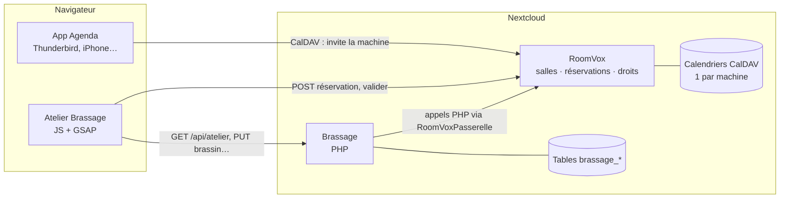
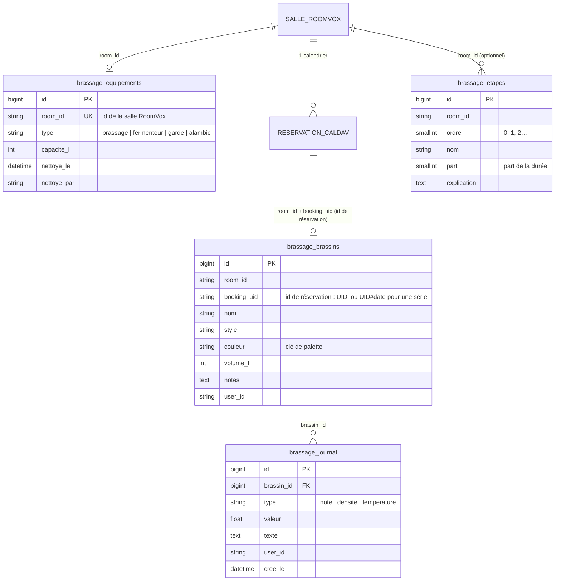
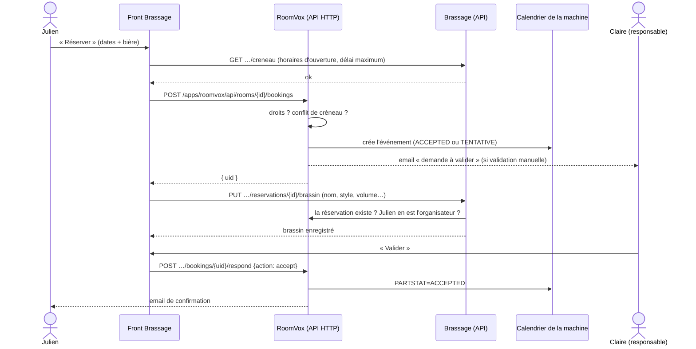

# 02 — Architecture

## L'idée en une phrase

**RoomVox gère les réservations, Brassage gère tout le reste** : contenu, avancement, mesures, nettoyage, et la vue animée. On ne recode pas ce que RoomVox fait déjà bien (créneaux, conflits, droits, validation, emails, synchronisation avec les agendas).



> 💡 **Pour comprendre — CalDAV.** C'est le protocole standard des agendas, comme IMAP pour les emails. Nextcloud stocke les agendas en CalDAV, ce qui permet à n'importe quel client (Apple Calendar, Thunderbird, Outlook…) de les lire et de les modifier. RoomVox crée **un calendrier par salle** : une réservation est simplement un événement dans le calendrier de la machine.

## Qui stocke quoi

| Information | Où | Pourquoi là |
|---|---|---|
| La machine (nom, validation auto ou non) | RoomVox (`oc_appconfig`) | C'est une « salle » RoomVox, visible aussi depuis l'Agenda |
| Les droits (qui voit / réserve / gère) | RoomVox (`oc_appconfig`) | On réutilise son système de rôles par groupe |
| Les réservations (qui, quand, statut) | Calendrier CalDAV de la machine | C'est le principe de RoomVox ; c'est la **source de vérité** |
| Type de machine, contenance, dernier nettoyage | `oc_brassage_equipements` | RoomVox ne connaît que des salles de réunion |
| Contenu d'une réservation (bière, style, volume, notes) | `oc_brassage_brassins` | Spécifique au brassage |
| Mesures et notes | `oc_brassage_journal` | Spécifique au brassage |
| Étapes **par défaut** d'un type de machine | Code : `lib/Service/Gabarits.php` | Valeurs de démo, à faire valider ([Q2](journal-de-bord.md#questions-ouvertes)) |
| Étapes **personnalisées** d'une machine | `oc_brassage_etapes` | Un·e responsable les règle dans le panneau ; sans elles, on prend celles du type ([D10](journal-de-bord.md#d10--étapes-modifiables-par-machine)) |

### Le lien entre les deux mondes



Il n'y a **pas de clé étrangère** vers RoomVox : ses données ne sont pas dans des tables SQL qu'on pourrait référencer. Conséquences :
- une machine **sans ligne** dans `brassage_equipements` est traitée comme un « Fermenteur » par défaut ;
- une machine **supprimée** dans RoomVox laisse des lignes orphelines chez nous. Elles sont ignorées à l'affichage, et `occ brassage:menage` les supprime ;
- de même pour une **réservation annulée** : son contenu reste en base jusqu'à `occ brassage:menage --reservations-annulees`.

## Les fichiers PHP (`app/lib/`)

```
lib/
├── AppInfo/Application.php      point d'entrée de l'app pour Nextcloud
├── Controller/                  portes d'entrée HTTP (une méthode = une route)
│   ├── ControleurBase.php       commun : erreurs → JSON, vérification des rôles
│   ├── PageController.php       la page HTML
│   ├── AtelierController.php    GET /api/atelier
│   ├── EquipementController.php réglages, étapes, nettoyage, vérification de créneau
│   ├── BrassinController.php    contenu d'une réservation
│   └── JournalController.php    mesures et notes
├── Service/
│   ├── RoomVoxPasserelle.php    ⚠ LE SEUL fichier qui connaît les classes de RoomVox
│   ├── AtelierService.php       assemble la « photo » de l'atelier pour un utilisateur
│   ├── Avancement.php           calcul du % et des étapes (pur, testé)
│   ├── Etapes.php               quelles étapes appliquer (personnalisées ou par défaut) + validation
│   ├── ReglesReservation.php    horaires d'ouverture + délai maximum (pur, testé)
│   └── Gabarits.php             étapes par défaut de chaque type de machine
├── Db/                          une Entity + un Mapper par table
├── Migration/                   création des tables
├── Exception/ErreurApi.php      erreurs « attendues » (400, 403, 404…)
└── Command/                     occ brassage:demo, occ brassage:menage
```

> 💡 **Pour comprendre — Contrôleur, Service, Mapper.** C'est le découpage classique d'une app web, en trois couches :
> - le **contrôleur** reçoit la requête HTTP et renvoie la réponse ;
> - le **service** contient la logique (« quelle réservation est en cours ? ») ;
> - le **mapper** lit et écrit en base.
>
> Chaque couche ne parle qu'à la suivante. On sait ainsi toujours où chercher.

> 💡 **Pour comprendre — Injection de dépendances.** Aucun fichier n'écrit `new AtelierService(...)`. Les classes déclarent ce dont elles ont besoin dans leur constructeur, et **Nextcloud les fabrique tout seul** en lisant les types des paramètres (c'est l'« autowiring »). C'est aussi ce qui permettrait de remplacer l'horloge (`ITimeFactory`) par une fausse dans des tests.

### La passerelle RoomVox

`RoomVoxPasserelle` est un **adaptateur** : il traduit le vocabulaire de RoomVox (`rooms`, `bookings`, `PARTSTAT=ACCEPTED`) en le nôtre (`salles`, `réservations`, `statut: confirmee`).

On y appelle **directement les services PHP de RoomVox** (`RoomService`, `CalDAVService`, `PermissionService`) au lieu de son API HTTP. C'est plus rapide et il n'y a pas de jeton à gérer. Le risque : ce ne sont **pas des API publiques garanties**, et une mise à jour de RoomVox peut les changer. D'où la règle : **aucun autre fichier n'importe `OCA\RoomVox\…`**. Si RoomVox change, on ne répare qu'ici. Voir [le journal](journal-de-bord.md#d3--appeler-roomvox-en-php-via-une-passerelle).

## Le parcours d'une réservation



Une réservation faite **depuis l'Agenda** suit le même chemin côté RoomVox (via CalDAV au lieu de l'API HTTP). Elle apparaît dans l'atelier avec « Contenu non renseigné », et l'organisateur peut le compléter depuis le panneau.

## Les droits

On réutilise **les rôles RoomVox** sans en inventer d'autres :

| Rôle RoomVox | Dans Brassage |
|---|---|
| *(aucun)* | Ne voit pas la machine (l'API répond 404, pas 403 : on ne révèle pas qu'elle existe) |
| `viewer` | Voit la machine, son contenu, son journal |
| `booker` | + réserve, ajoute au journal, déclare le nettoyage, renseigne le contenu **de ses propres réservations** |
| `manager` | + renseigne le contenu de toutes les réservations, valide les demandes, règle la machine (nom, type, contenance, **étapes**), supprime toute entrée du journal |
| admin Nextcloud | Toujours `manager` ; seul à pouvoir créer et supprimer des machines (règle de RoomVox) |

**Le front n'est jamais une sécurité** : il cache les boutons inutiles, mais **chaque route PHP revérifie les droits** (`ControleurBase::exigerRole()`).

## Le calcul de l'avancement

Choix retenu : **l'avancement, c'est le temps** (voir [D5](journal-de-bord.md#d5--lavancement--le-temps-écoulé)).

```
pourcentage = (maintenant − début de la réservation) / (fin − début)
```

Les étapes de la machine sont posées sur la durée de la réservation, chacune selon sa **part**. Ce sont ses étapes personnalisées si un·e responsable en a défini, sinon celles de son type (`Gabarits.php`). C'est `Etapes::pour()` qui choisit. Un fermenteur réservé 28 jours avec « Fermentation principale » à 25 % donne une étape de 7 jours.

Le calcul est fait **côté serveur** (`Avancement.php`, testé), puis **refait côté navigateur** toutes les 30 secondes (`src/temps.js`) pour que les jauges avancent sans recharger. Le navigateur se recale sur l'heure du serveur, au cas où l'horloge de l'ordinateur serait fausse.
