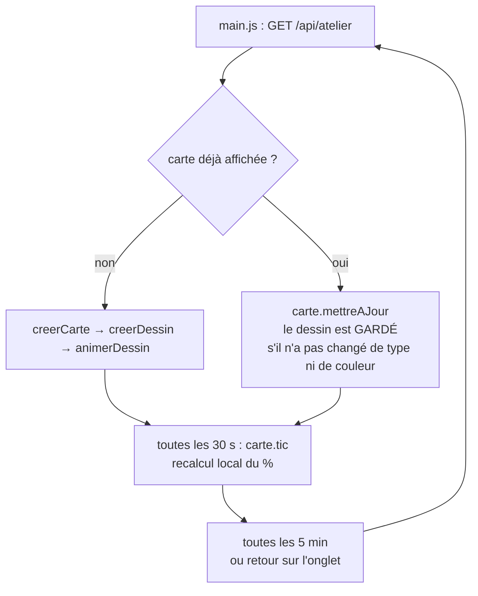

# 03 — Front et animations

## Les fichiers (`app/src/`)

```
src/
├── main.js        démarrage, chargement de l'atelier, boucle de rafraîchissement
├── carte.js       une carte = une machine (dessin, jauge, contenu, qui)
├── panneau.js     le panneau de détail (étapes, contenu, journal, actions)
├── animations.js  tout ce qui bouge (GSAP)
├── dessins.js     charge les SVG et les rend « uniques » (préfixe des id)
├── dessins/*.svg  les 4 dessins de machines
├── temps.js       horloge recalée sur le serveur + avancement en direct
├── api.js         tous les appels HTTP (Brassage et RoomVox)
├── couleurs.js    palette des bières
└── format.js      dates, durées, échappement HTML
```

**Pas de framework** (ni Vue, ni React) : voir [D6](journal-de-bord.md#d6--pas-de-framework-front). Chaque fichier est un *module ES* qui exporte quelques fonctions. **Vite** les assemble en un seul fichier, `js/brassage-main.js`, que Nextcloud charge dans la page.

> 💡 **Pour comprendre — Pourquoi « compiler » du JavaScript ?** Le navigateur pourrait lire nos fichiers un par un. Mais on utilise aussi des paquets npm (`gsap`, `@nextcloud/router`…) installés dans `node_modules/`, que le navigateur ne sait pas trouver. Vite suit les `import`, rassemble tout, et compresse le résultat.

## Le cycle de vie d'une carte



Le dessin et ses animations **survivent** aux rafraîchissements : les bulles ne repartent pas de zéro toutes les 5 minutes.

Le panneau n'est **redessiné que si quelque chose a vraiment changé** : on compare les données sans le champ `avancement`, qui change tout seul avec le temps. Sinon, `panneau.tic()` fait seulement avancer le pourcentage, le temps restant et le curseur de la frise, toutes les 30 s.

## Les dessins SVG et leur « contrat d'animation »

Les 4 dessins (`src/dessins/*.svg`) suivent le style de `alambic.svg`, l'illustration de référence du projet : mêmes dégradés `steel`, `steelLight`, `copper`, `gold`, même cadrage `1200 × 760`, même ligne de sol.

Ils partagent surtout **les mêmes `id` pour les mêmes rôles**. C'est ce « contrat » qui permet à `animations.js` d'animer n'importe quelle machine avec le même code :

| `id` | Rôle | Présent dans |
|---|---|---|
| `liquid-level` | Rectangle du liquide dans le hublot. **Doit avoir `data-haut` et `data-bas`** (limites du hublot, en unités SVG) | tous |
| `liquid-surface` | Ligne de surface, qui suit le niveau et ondule | tous |
| `tank-bubbles` | Groupe de `<circle>` qui montent quand la machine tourne | tous |
| `gold` | Dégradé du liquide, **recoloré** selon la bière (`couleurs.js`) | tous |
| `gauge-main-needle` | Aiguille du cadran : repos −55°, marche +25° | tous |
| `light-running`, `light-ready`, `light-idle` | Voyants : en marche, prêt, au repos | tous |
| `vapor-flow`, `column-bubbles`, `product-drops`, `coil-copper`, `gauge-column-needle` | Vapeur, colonne, gouttes, serpentin | alambic |
| `steam`, `flames`, `paddle`, `pump-rotor`, `recirc-flow` | Vapeur, brûleur, fourquet, pompe | brassage |
| `airlock-bubble`, `cooling-flow` | Barboteur, circuit de froid | fermenteur |
| `temp-display` | Écran : **dernière température du journal**, « --,- » sans mesure | brassage, fermenteur, garde |
| `frost`, `cooling-flow`, `bottle-fill-1` … `-4` | Givre, froid, bouteilles qui se remplissent pendant le conditionnement | garde |

Un `id` absent n'est pas une erreur : l'animation correspondante est simplement sautée.

### Le problème des `id` en double

Dans une page HTML, un `id` doit être **unique**. Or six machines affichées donnent six `id="gold"`, et les dégradés de la 2e machine pointeraient vers ceux de la 1re. `dessins.js` règle ça en **préfixant** tous les `id` et toutes les références `url(#…)` à chaque copie : `id="d3-gold"`, `fill="url(#d3-gold)"`. On retrouve ensuite un élément avec `dessin.partie('gold')`.

## GSAP, ce qu'il faut savoir pour lire `animations.js`

> 💡 **Pour comprendre — GSAP en 6 notions.**
> - `gsap.to(el, { y: -40, duration: 1 })` : anime **vers** une valeur.
> - `gsap.fromTo(el, {de}, {vers})` : part d'une valeur précise.
> - `repeat: -1` répète à l'infini ; `yoyo: true` fait l'aller-retour.
> - `ease` : la courbe du mouvement. `sine.inOut` est doux, `power2.out` freine à la fin, `back.out` dépasse un peu puis revient.
> - `keyframes: { y: [0, -40], opacity: [0, 1, 1, 0] }` : plusieurs valeurs réparties sur la durée (une bulle qui apparaît, monte et s'efface).
> - `gsap.context()` : regroupe les animations d'un élément. `ctx.revert()` les arrête **toutes** et remet les éléments dans leur état d'origine. Indispensable avant de supprimer un dessin, sinon les animations tournent dans le vide (fuite mémoire).

Quelques techniques utilisées :

- **Le liquide qui monte** : on anime les attributs `y` et `height` du rectangle (`attr: { y, height }`), et on décale la ligne de surface de la même quantité.
- **Le flux dans un tuyau** : le tuyau a un trait en tirets (`stroke-dasharray`). Décaler ces tirets en boucle (`stroke-dashoffset`) donne l'impression que ça circule.
- **L'arc de progression** : un cercle dont le trait est un seul « tiret » de la longueur du cercle (2πr). Un décalage de `longueur × (1 − ratio)` n'en montre que la bonne portion. On calcule 2πr au lieu d'appeler `getTotalLength()`, qui plante si l'élément n'est pas encore affiché.
- **Le pivot des aiguilles** : elles sont dessinées autour du point (0,0) de leur groupe, alors que GSAP mesure le pivot depuis le coin de la boîte de l'élément (`getBBox`). `pivotLocal()` fait la conversion.
- **L'entrée des cartes** : `gsap.from(cartes, { y: 28, opacity: 0, stagger: 0.08 })`. Les cartes arrivent l'une après l'autre.

### Accessibilité

- **`prefers-reduced-motion`** : si la personne a demandé à son système de réduire les animations, aucune boucle ne tourne. Le décor est affiché figé et les chiffres directement à leur valeur finale.
- Les cartes sont **utilisables au clavier** (Tab, puis Entrée ou Espace). Le panneau se ferme avec Échap et rend le focus à la carte.
- Panneau ouvert : le reste de l'atelier devient **inerte** (attribut `inert` : ni clic, ni focus, ignoré par les lecteurs d'écran) et **Tab tourne en boucle dans le panneau** (« piège à focus »), comme dans une vraie fenêtre modale.
- Les couleurs de statut sont assez foncées pour que le texte blanc des pastilles atteigne un **contraste de 4,5:1** (norme WCAG AA).
- Toute donnée venant du serveur passe par `echapper()` avant d'être insérée en HTML : c'est la protection contre les failles XSS.

## Recettes

### Ajouter un type de machine (ex. « embouteilleuse »)

1. **Dessin** : copier `src/dessins/garde.svg` en `embouteilleuse.svg`, et garder au minimum les `id` du contrat (`liquid-level` avec `data-haut`/`data-bas`, `gold`…).
2. **Front** :
   - `dessins.js` : l'importer et l'ajouter à `SOURCES` ;
   - `panneau.js` : ajouter le libellé dans `LIBELLES_TYPES` et la durée habituelle dans `DUREE_PAR_DEFAUT` ;
   - si besoin, des boucles spécifiques dans `animations.js` (comme `bouclesGarde`).
3. **Back** :
   - `Db/Equipement.php` : ajouter le type à `TYPES` ;
   - `Service/Gabarits.php` : ajouter son libellé et ses étapes.
4. `./scripts/deployer.sh`, sans oublier de **monter la version** dans `appinfo/info.xml` (voir [05 — Développer](05-developper.md#piège-n1--le-cache-du-navigateur)).

### Changer les étapes d'une machine

Pas besoin de code : un·e responsable ouvre la machine → *Étapes de la machine*. On peut ajouter, renommer, réordonner et supprimer des étapes, et régler leur **part** du temps : la durée correspondante s'affiche en direct. Pour changer les étapes **par défaut** d'un type, pour toutes les machines qui ne sont pas personnalisées, il faut modifier `lib/Service/Gabarits.php`.

L'éditeur travaille sur un **brouillon** : rien n'est envoyé avant « Enregistrer ». Pour ne pas perdre la saisie, le panneau ne se redessine pas pendant qu'on tape, même lors du rafraîchissement automatique toutes les 5 minutes (variable `saisieEnCours` dans `panneau.js`).

### Retoucher un dessin

Les `.svg` s'ouvrent dans Inkscape, Figma ou un éditeur de texte. Deux règles :
- garder les `id` du contrat ;
- mettre à jour `data-haut`/`data-bas` si on déplace le hublot.

Pour voir le résultat : `./scripts/deployer.sh`.
